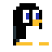

# Pawsible



Pawsible puts a little pet on your desktop. Click it to chat, keep todos, and save memories. Jamun, the penguin, is included, and other characters become available when their sprite sheets are installed locally.

Built for Fedora GNOME with Wayland and XWayland.

## Install

From this directory, with Python available:

```sh
python -m pip install -r requirements.txt
python main.py
```

Pawsible uses Python's built-in `sqlite3` module to create a local SQLite database automatically. It needs no separate database server or pip package. On Fedora, the file is normally at `~/.local/share/jamun/jamun.sqlite3`.

The included `sprites/` directory provides the penguin animations.

## Characters

Choose an available character from the pet's right-click menu or Settings. You can also run `python main.py --character fox` to select one from the command line. The choice persists across launches. `python main.py --preview --character fox` previews its frames.

The optional character manifests are included. To enable a character whose sprite is absent, download its sheet from the creator and place it at the exact path below, relative to this repository:

| Character | Local sprite path |
| --- | --- |
| Midnight cat | `Free_Cat_sprites/Cat_Sprite_Sheet_Black.png` |
| Shadow cat | `black_cat_sprites/Sheet_Cat_*.png` (all nine sheets) |
| White cat | `white_cat_sprites/Cat Sprite Sheet.png` |
| Fox | `fox sprites/Fox Sprite Sheet.png` |

To install optional characters, download the sheet yourself and copy only the named PNG files into this repository:

1. For **Shadow cat**, download [Cat Sprite Pack by Jules](https://julesleech.itch.io/cat-sprite-pack?utm_source=chatgpt.com). Create `black_cat_sprites/` in this repository and copy these nine PNG sheets into it: `Sheet_Cat_Sat.png`, `Sheet_Cat_Run.png`, `Sheet_Cat_Attack.png`, `Sheet_Cat_Hurt.png`, `Sheet_Cat_Jump.png`, `Sheet_Cat_Playing.png`, `Sheet_Cat_Sad.png`, `Sheet_Cat_Sleep.png`, and `Sheet_Cat_Dizzy.png`. Rename the last file to `Sheet_Cat_Knocked.png`, which is the name the manifest expects. The GIFs are not needed.
2. For **Midnight cat**, download [Cat Pack by octopusINKUS](https://octopusinkus.itch.io/cat-pack?utm_source=chatgpt.com). Find `Cat_Sprite_Sheet_Black.png` in the downloaded pack, create `Free_Cat_sprites/` in this repository, and copy that PNG into the directory. If your download does not contain the black sheet, obtain the pack version that includes it.
3. For **White cat**, download [2D Pixel Art Cat Sprites by Elthen](https://elthen.itch.io/2d-pixel-art-cat-sprites?utm_source=chatgpt.com). Create `white_cat_sprites/` and copy `Cat Sprite Sheet.png` into it.
4. For **Fox**, download [2D Pixel Art Fox Sprites by Elthen](https://elthen.itch.io/2d-pixel-art-fox-sprites?utm_source=chatgpt.com). Create `fox sprites/` and copy `Fox Sprite Sheet.png` into it. Keep the space in the folder and file names.
5. If Pawsible is running, right-click the pet and choose Quit. Then run `python main.py --command pet` from this repository and choose a character from the pet's right-click menu or Settings. Pawsible scans for sprites when it starts, so opening it again without quitting the old process will not refresh the list.

All four optional sprite folders are ignored by Git; keep their sprites on your own machine. Jules allows personal use but prohibits redistributing the Shadow cat pack. [Elthen's current license](https://www.patreon.com/elthen/posts/licensing-27430241) allows use in projects but prohibits redistributing the raw Fox and White cat assets. Missing sheets remove only that character from the selector, so the app still starts with the penguin.

To start Pawsible automatically when you log in, run:

```sh
python install_startup.py install
```

The script adds a GNOME autostart entry that launches Pawsible hidden at your next login. It does not install keyboard shortcuts; use the separate command under Controls. Run `python install_startup.py remove` to undo it.

## Set up chat

Create a [Gemini API key](https://ai.google.dev/gemini-api/docs/api-key) in Google AI Studio. Run `install -m 600 .env.example .env`, replace `replace-with-your-key` in `.env` with your key, then restart Pawsible. Gemini-powered chat, todos, and memory use `gemini-3.5-flash-lite` by default; you can change the model in Settings. The pet works without a key.

## Controls

Run `python main.py --install-shortcuts` to add the default GNOME shortcuts:

| Shortcut | Action |
| --- | --- |
| `Shift+Space` | Open or focus chat |
| `Ctrl+Alt+Space` | Hide the pet and chat |

Click the pet to open chat, drag it to move it, or right-click it for Settings and Quit. In chat, `Ctrl+N` starts a conversation, `Ctrl+1/2/3` switches between Chat, Todos, and Memory, and `Esc` returns to the pet.

## Credits

Penguin sprites: [PENGU by stext25](https://stext25.itch.io/pengu).

Fox sprites: [2D Pixel Art Fox Sprites by Elthen](https://elthen.itch.io/2d-pixel-art-fox-sprites?utm_source=chatgpt.com).

White cat sprites: [2D Pixel Art Cat Sprites by Elthen](https://elthen.itch.io/2d-pixel-art-cat-sprites?utm_source=chatgpt.com).

Shadow cat sprites: [Cat Sprite Pack by Jules](https://julesleech.itch.io/cat-sprite-pack?utm_source=chatgpt.com).

Midnight cat sprites: [Cat Pack by octopusINKUS](https://octopusinkus.itch.io/cat-pack?utm_source=chatgpt.com).
